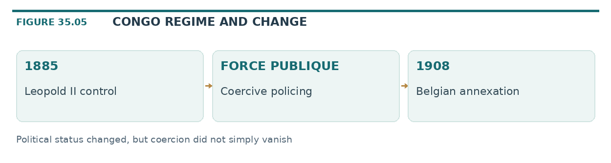

The Congo River basin became the setting for one of the most infamous colonial regimes. Belgium's King Leopold II supported exploration and established organizations presented publicly as scientific or humanitarian ventures while pursuing territorial control. His agents sought agreements, and European diplomats negotiated the commercial and political status of the region. By 1885 the Congo Free State emerged as a distinct state under Leopold's personal sovereignty, not simply as an ordinary Belgian colony. Formal Belgian annexation came only in 1908.

Conquest and administration were uneven. The <em>Force Publique</em>, established in 1885, was an armed force with African rank-and-file soldiers under European command. Private concession companies and state officials extracted labor and resources, especially ivory and, later, wild rubber. Communities were subjected to quotas, hostage-taking, violence, forced porterage and severe punishment. Enormous suffering and demographic upheaval are strongly documented; attempts to state one precise total of deaths from colonial atrocities, disease, hunger and declining births involve major uncertainty.

<figure class="figure" id="figure-35-5">

<figcaption>Figure 35.5. Political status changed, but coercion did not simply vanish. <a class="figure-anchor" href="#figure-35-5" aria-label="Link to this figure">#</a></figcaption>
</figure>

The Congo case shows how the rhetoric of free trade and suppressing slavery could coexist with coercive labor systems. It also shows that even the Berlin Conference should not be pictured as an event in which delegates simply handed Leopold a fully mapped country. Recognition, sovereignty claims, treaties, and actual coercive occupation developed through overlapping diplomatic processes. Reports by African witnesses, missionaries, officials, investigators and reformers eventually exposed the regime, but international criticism alone did not immediately end exploitation. \[<a href="/035-imperialism-and-african-partition/sources/#source-5" class="cite">5</a>\]\[<a href="/035-imperialism-and-african-partition/sources/#source-6" class="cite">6</a>\]
