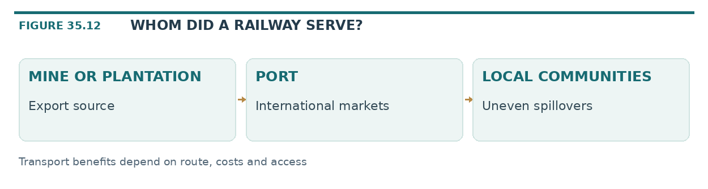

Colonial infrastructure is sometimes discussed in terms of a misleading choice: either railways were gifts of modernization or they were purely useless instruments of extraction. Both descriptions flatten varied histories. Railways did connect ports to mining districts, cash-crop zones and administrative centers. They could reduce transport costs, support migration and facilitate new markets. But route selection frequently served commercial concessions and military strategy rather than the balanced mobility needs of all communities.

Imagine a hypothetical colony with two possible routes. A line from a copper district to a coastal port promises large export revenue; a second line linking several densely populated farming towns could improve local food markets but generate smaller immediate receipts to the colonial treasury. An administration prioritizing tax and export revenue may choose the first line, even if the second has broader developmental benefits. The example is invented, but the analytical distinction is real: <strong>infrastructure can have productive effects while being planned under unequal political priorities</strong>.

<figure class="figure" id="figure-35-12">

<figcaption>Figure 35.12. Transport benefits depend on route, costs and access. <a class="figure-anchor" href="#figure-35-12" aria-label="Link to this figure">#</a></figcaption>
</figure>

Railways also required land acquisition, labor, policing and financing. Construction costs might be borne through public debt, customs revenue or forced work; subsequent gains could be distributed among European shareholders, colonial officials and African farmers or traders in very different proportions. To evaluate a railway, ask who paid, who was displaced, who could travel, what it connected and what alternative investments were excluded. A surviving bridge alone cannot answer those questions.
