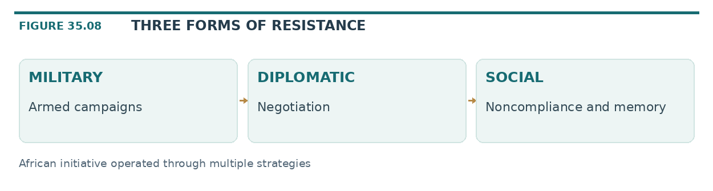

Samori Touré built a powerful state in western Africa during the late nineteenth century, mobilizing armies, acquiring firearms, reorganizing supply and moving his political center in response to French advances. His campaigns against expanding French rule continued over years before his capture in 1898. He also conquered and coerced other African communities; recognizing his resistance to France does not require imagining that his own state was free of expansion or violence. Histories of resistance become stronger when African leaders are treated as real strategists, not flawless symbols.

Asante, centered in what is now Ghana, faced a long series of conflicts with the British. Political disputes, commercial rivalries and warfare preceded the late scramble period. In 1900, Yaa Asantewaa helped lead armed resistance after a British demand concerning the Golden Stool, a central symbol of Asante authority. The war ended in British victory, and Ashanti was annexed in 1901, but its political and cultural life was not extinguished. The Smithsonian's National Museum of African Art highlights Yaa Asantewaa as a major figure of resistance. \[<a href="/035-imperialism-and-african-partition/sources/#source-10" class="cite">10</a>\]

<figure class="figure" id="figure-35-8">

<figcaption>Figure 35.8. African initiative operated through multiple strategies. <a class="figure-anchor" href="#figure-35-8" aria-label="Link to this figure">#</a></figcaption>
</figure>

Comparing Samori and Asante reveals different possibilities. A ruler might centralize military power or seek alliances, shift territory or fight to preserve sacred and constitutional authority. None of these strategies guaranteed victory against expanding armies backed by wider imperial resources. But none can be reduced to an inevitable defeat either. Resistance altered costs, timing, political settlements and memories of legitimate rule.
