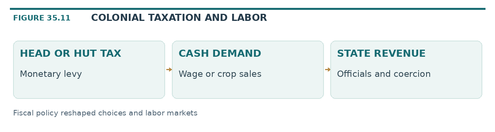

Colonial administrations required resources to pay soldiers, officials, communications systems and infrastructure. They commonly relied on customs duties, hut or head taxes and other levies. Tax obligations could push people toward wage labor or marketed crops when payment had to be made in money. Yet the effects depended on access to markets, local farming patterns and the ability to negotiate or evade demands. Taxation was simultaneously a source of revenue, a means of political control and a tool for reorganizing labor.

In some colonies, forced labor compelled people to build roads, carry loads, cultivate specific crops or perform state duties without genuinely free consent. Concession companies and local administrators imposed especially severe burdens in certain districts. In other places African smallholders adopted commercial crops voluntarily or partly under pressure, sometimes earning incomes and organizing strong producer networks. Distinguishing commercial opportunity from coercion is essential; both could be present in the same local economy.

<figure class="figure" id="figure-35-11">

<figcaption>Figure 35.11. Fiscal policy reshaped choices and labor markets. <a class="figure-anchor" href="#figure-35-11" aria-label="Link to this figure">#</a></figcaption>
</figure>

Recent research reconstructing colonial taxation shows that early administrations had limited fiscal capacity and depended on trade taxes and labor obligations. This helps explain why a vast-colored imperial map might hide a very shallow bureaucratic state. A ruler who could announce a new tax could not always collect it; officials negotiated through brokers and sometimes relied on punishment when compliance failed. \[<a href="/035-imperialism-and-african-partition/sources/#source-13" class="cite">13</a>\]
