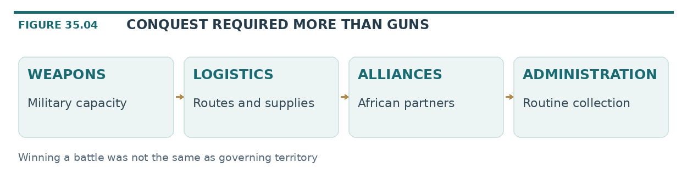

European conquest has sometimes been summarized as a contest between machine guns and spears. That is misleading. African forces possessed or acquired firearms of different kinds, modified their tactics, constructed defenses, organized cavalry and used terrain skillfully. At the same time, European forces increasingly benefited from breech-loading rifles, artillery, later machine guns, steam transport and networks for obtaining ammunition and replacement supplies. The military balance varied greatly by decade, terrain, local alliances and the resources of the fighting parties.

Disease had historically constrained many Europeans moving into tropical regions. Quinine, used against malaria, made some journeys and garrisons more sustainable, but its protective benefits depended on correct use and knowledge; epidemics, including malaria and yellow fever, remained serious problems. Railways could support supply and troop deployment, yet building them required expensive surveys, land and labor. Rivers offered routes but also rapids, waterfalls and seasonal obstacles. Transport across deserts, mountains and forest zones could still be slow and dangerous.

<figure class="figure" id="figure-35-4">

<figcaption>Figure 35.4. Winning a battle was not the same as governing territory. <a class="figure-anchor" href="#figure-35-4" aria-label="Link to this figure">#</a></figcaption>
</figure>

No technology made conquest automatic. An army that could defeat an opponent in open battle might be unable to police every village or compel reliable tax payment. Many imperial victories depended on African soldiers, porters, guides, suppliers, translators and allied political leaders, whose motives varied. Such dependence complicates any simple picture of a tiny European army conquering a continent by superior weapons alone. Military power made some occupations possible; it did not explain them without politics and local histories.
