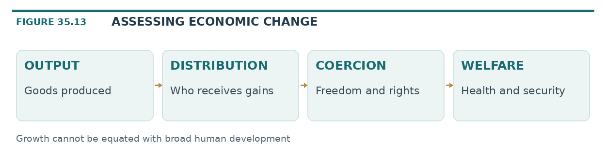

A debate over colonial economic legacies often presents opposing images: one side points to roads, railways, ports and new crops; another points to dispossession, forced labor and unequal trade. The first image can overlook who controlled investment and whose labor paid for it. The second can miss the economic initiative of African workers and farmers, some of whom benefited from new or expanded markets under severely unequal conditions. Both sets of observations can be true, and neither alone measures total welfare.

Think about a specific cash-crop region. A farmer's household can earn more from cocoa than from a previous mix of activities, but may also face taxes, price volatility and obligations that reduce freedom of choice. A nearby district may lose forest access to concessions without receiving comparable benefits. A port city can grow while rural communities lose services. Aggregate export revenue therefore cannot stand in for improvements in health, nutrition, political rights or income distribution. Colonial GDP estimates, where available, require attention to incomplete records and definitions.

<figure class="figure" id="figure-35-13">

<figcaption>Figure 35.13. Growth cannot be equated with broad human development. <a class="figure-anchor" href="#figure-35-13" aria-label="Link to this figure">#</a></figcaption>
</figure>

Economic historians compare institutions, endowments and different colonial trajectories. They ask whether extraction discouraged investment in local manufacturing, whether political barriers limited African enterprise, and how colonial states distributed education, health and transport. There is no reliable universal verdict that every precolonial economy was prosperous or that every colonial economic change was uniformly harmful in the same way. There is, however, overwhelming evidence that colonial sovereignty was unequal and frequently imposed enormous involuntary costs on African populations. \[<a href="/035-imperialism-and-african-partition/sources/#source-14" class="cite">14</a>\]\[<a href="/035-imperialism-and-african-partition/sources/#source-15" class="cite">15</a>\]
