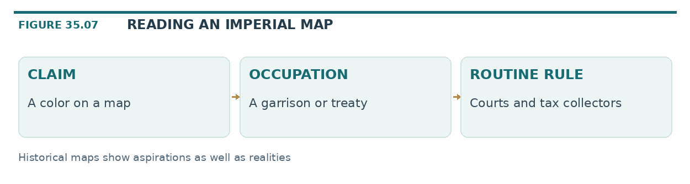

Historical maps are necessary, but they invite a dangerous shortcut. One map colors Africa according to European claims in 1880; another shows formal imperial borders around 1914. Their sharp contrast captures the speed of partition. Yet the colored patches can mislead if a viewer assumes that every square kilometer was effectively governed by the date printed above the map. A frontier district with one patrol and a signed treaty differed from a settled colonial capital linked by rail to plantations and police posts.

Maps also distort African histories by foregrounding European border-making and hiding older overlapping authorities. A pastoral community might use land on both sides of a new frontier. A kingdom might claim tribute from scattered settlements rather than rule a compact block of territory. Border commissions sometimes followed rivers, latitude lines or transport routes, and in other cases drew on knowledge of earlier African boundaries. Recent scholarship shows that some boundaries were more intentionally designed—and occasionally more responsive to existing political landscapes—than the popular claim that they were entirely random implies. \[<a href="/035-imperialism-and-african-partition/sources/#source-9" class="cite">9</a>\]

<figure class="figure" id="figure-35-7">

<figcaption>Figure 35.7. Historical maps show aspirations as well as realities. <a class="figure-anchor" href="#figure-35-7" aria-label="Link to this figure">#</a></figcaption>
</figure>

The right question is not simply whether the lines were 'arbitrary.' Ask <strong>arbitrary relative to whose claims and purposes?</strong> A boundary could be rational for European negotiators seeking a railway, but disruptive for farmers. It could use a river as an obvious cartographic divider while splitting a market network that had always crossed it. We should distinguish the origins of boundaries from the later choices of independent African governments, which generally inherited colonial frontiers for reasons tied to security and interstate stability.
