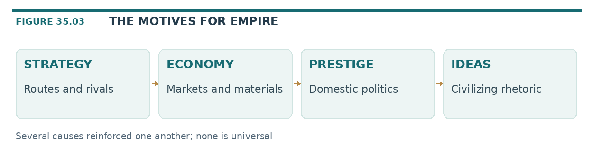

Explanations of the Scramble often start with European industrialization. Steamships could reduce the cost of moving people and goods along navigable waterways; telegraphs accelerated communication; improvements in firearms and logistics could widen military disparities. Industrial manufacturers and investors sought markets, raw materials and opportunities for profit. But these developments alone do not explain which places were conquered, when, or at what cost. Other regions with profitable commerce experienced different political outcomes, and some African colonies cost European treasuries more than they returned in the short run.

Strategic rivalry was equally important. British officials cared about the sea route to India, access through the Suez Canal, and the Nile valley. French policy after 1870 mixed commercial ambition, military status, party politics and strategic competition. German colonial ventures reflected shifting political calculations and pressures from lobbyists. Portugal asserted older claims, Italy sought standing among European states, and Belgium's King Leopold II pursued a personal imperial project in the Congo. Domestic politicians sometimes treated an overseas possession as proof of national prestige even when its economic value was disputed.

<figure class="figure" id="figure-35-3">

<figcaption>Figure 35.3. Several causes reinforced one another; none is universal. <a class="figure-anchor" href="#figure-35-3" aria-label="Link to this figure">#</a></figcaption>
</figure>

Historians accordingly debate the weight of capitalism, strategic competition, nationalism, missionary ideology, domestic politics, local African conflicts and contingent events. The explanations interact rather than compete in a winner-takes-all contest. A rumor about another state's treaty could spur an imperial declaration; a company could demand military intervention; a frontier war could create pressure for direct annexation. The Scramble accelerated through feedback among political anxiety, opportunity, violence and claims of necessity. \[<a href="/035-imperialism-and-african-partition/sources/#source-3" class="cite">3</a>\]\[<a href="/035-imperialism-and-african-partition/sources/#source-4" class="cite">4</a>\]
