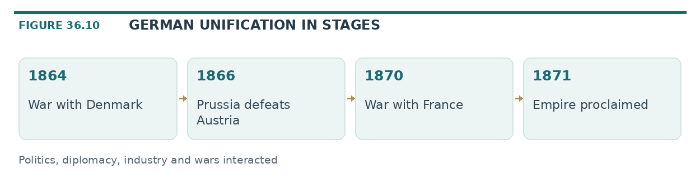

Otto von Bismarck became Prussia's minister-president in 1862 amid a dispute over military reorganization and the state budget. He was a conservative statesman who used nationalist opportunities without accepting parliamentary sovereignty. In 1864 Prussia and Austria fought Denmark over Schleswig and Holstein. The resulting arrangements intensified rivalry between the two powers. In 1866 Prussia defeated Austria and its allies, dissolved the German Confederation and organized the North German Confederation under Prussian leadership. \[<a href="/036-nationalism-and-the-nineteenth-century-nation-state/sources/#source-8" class="cite">8</a>\]\[<a href="/036-nationalism-and-the-nineteenth-century-nation-state/sources/#source-15" class="cite">15</a>\]

In 1870 the diplomatic crisis surrounding the Spanish throne and the editing of the Ems Dispatch contributed to war between France and Prussia and its German allies. Military victory and the participation of southern German states made national unification politically feasible. The German Empire was proclaimed at Versailles on 18 January 1871, before the peace settlement with France. France's loss of Alsace and part of Lorraine created bitterness and became a major problem in later European diplomacy. \[<a href="/036-nationalism-and-the-nineteenth-century-nation-state/sources/#source-15" class="cite">15</a>\]\[<a href="/036-nationalism-and-the-nineteenth-century-nation-state/sources/#source-16" class="cite">16</a>\]

<figure class="figure" id="figure-36-10">

<figcaption>Figure 36.10. Politics, diplomacy, industry and wars interacted. <a class="figure-anchor" href="#figure-36-10" aria-label="Link to this figure">#</a></figcaption>
</figure>

It would be wrong to say Bismarck united Germany by 'three wars alone.' Military reform, growing industry, rail transport, taxes, public nationalism, southern-state agreements and the international balance of power all mattered. It would be equally wrong to imagine the empire as simply a democratic popular achievement. The emperor, chancellor, federal princes and military command retained considerable authority, although elected institutions and parties also operated within the new system.
