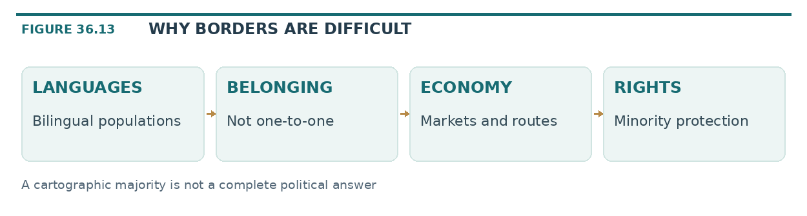

The phrase <em>national self-determination</em> sounds simple until one asks which population forms the unit entitled to choose. A city may have several language communities, villages in the same valley may identify differently, and a region may contain strategically important roads or ports. If a majority wishes to join one state, what protections should a local minority receive? If a historic kingdom claims an old frontier, should that outweigh the preferences of people currently living there? Nineteenth-century diplomacy rarely answered such questions consistently.

A map assigning a single color to each language or nationality often conceals bilingual households, intermarriage, seasonal migration and urban mixing. Some maps used census data gathered by administrations with an interest in presenting a particular demographic pattern. Other maps relied on school attendance or church jurisdiction as proxies for identity. In Habsburg lands official language classifications sometimes encouraged people to choose one label from a more complex set of practices. \[<a href="/036-nationalism-and-the-nineteenth-century-nation-state/sources/#source-19" class="cite">19</a>\]

<figure class="figure" id="figure-36-13">

<figcaption>Figure 36.13. A cartographic majority is not a complete political answer. <a class="figure-anchor" href="#figure-36-13" aria-label="Link to this figure">#</a></figcaption>
</figure>

It is thus misleading to imagine that nationalism solved the border question by replacing dynastic maps with 'natural' ones. Even where the principle of self-government gained acceptance, enforcing a territorial answer could produce new minorities and inequalities. This is one reason why later national conflicts often revolved around schools, worship, censuses and administrative appointments as much as armies.
