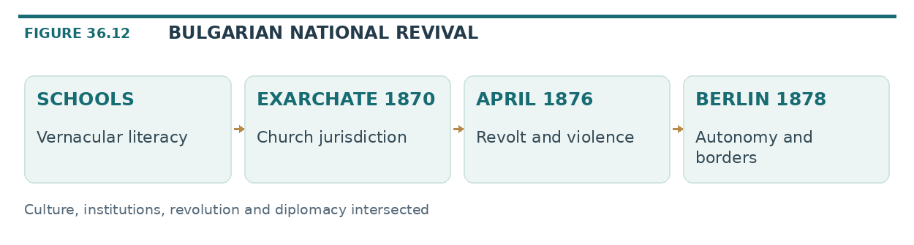

The Bulgarian National Revival developed through changing commerce, vernacular writing, historical interest, schools, religious organization and political agitation under Ottoman rule. Paisii of Hilendar's eighteenth-century historical writing became influential in later national memory; nineteenth-century teachers and publishers then helped expand Bulgarian-language education. National revival was neither one institution nor a single path from book to battlefield. Local communities financed classrooms and churches, and networks in towns inside and outside Ottoman territories supported teachers, newspapers and political debate. \[<a href="/036-nationalism-and-the-nineteenth-century-nation-state/sources/#source-24" class="cite">24</a>\]\[<a href="/036-nationalism-and-the-nineteenth-century-nation-state/sources/#source-25" class="cite">25</a>\]

The struggle for church autonomy was especially significant. The Ottoman decree establishing the Bulgarian Exarchate in 1870 created a recognized religious institution associated with Bulgarian national organization. Yet church and national boundaries overlapped imperfectly. Disputes involving the Ecumenical Patriarchate, Exarchate and local congregations often became contests over language, jurisdiction and identity. The same school or church could be viewed by different actors as education, spiritual authority or evidence for future territorial claims. \[<a href="/036-nationalism-and-the-nineteenth-century-nation-state/sources/#source-25" class="cite">25</a>\]

<figure class="figure" id="figure-36-12">

<figcaption>Figure 36.12. Culture, institutions, revolution and diplomacy intersected. <a class="figure-anchor" href="#figure-36-12" aria-label="Link to this figure">#</a></figcaption>
</figure>

Revolutionary circles, including figures such as Vasil Levski and Hristo Botev, pursued liberation by armed and organizational means. The April Uprising of 1876 and the repression that followed drew international attention to violence against civilians. The Russo-Ottoman War of 1877–1878 and the Treaty of San Stefano preceded the revised Congress of Berlin settlement: the Principality of Bulgaria was autonomous under Ottoman suzerainty, Eastern Rumelia remained an autonomous Ottoman province, and other disputed areas remained under Ottoman administration. These settlements cannot be reduced to the triumph of a single national principle. \[<a href="/036-nationalism-and-the-nineteenth-century-nation-state/sources/#source-25" class="cite">25</a>\]\[<a href="/036-nationalism-and-the-nineteenth-century-nation-state/sources/#source-26" class="cite">26</a>\]
