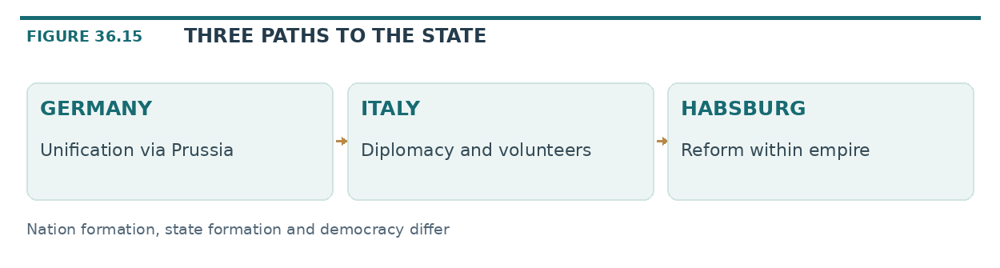

Consider three pathways side by side. Germany became a unified empire largely through Prussian military, diplomatic and institutional dominance, building on a partly integrated economic landscape. Italy emerged through combinations of volunteer campaigns, Piedmontese state power, plebiscites, wars and diplomatic opportunity. The Habsburg and Ottoman empires attempted reform and common political membership while confronting competing national claims. None of these outcomes was merely the automatic result of people sharing a language. \[<a href="/036-nationalism-and-the-nineteenth-century-nation-state/sources/#source-13" class="cite">13</a>\]\[<a href="/036-nationalism-and-the-nineteenth-century-nation-state/sources/#source-15" class="cite">15</a>\]\[<a href="/036-nationalism-and-the-nineteenth-century-nation-state/sources/#source-17" class="cite">17</a>\]\[<a href="/036-nationalism-and-the-nineteenth-century-nation-state/sources/#source-21" class="cite">21</a>\]

The comparison clarifies the difference between <em>nation formation</em>, <em>state formation</em> and <em>democratization</em>. National activists may cultivate a collective identity. A new state may consolidate taxation, schools and military power. Democratic reform determines who has voice in those decisions. These processes can reinforce one another, but they can also move in opposite directions. Unification might make a government stronger while narrowing the freedom of groups who disagree with its borders.

<figure class="figure" id="figure-36-15">

<figcaption>Figure 36.15. Nation formation, state formation and democracy differ. <a class="figure-anchor" href="#figure-36-15" aria-label="Link to this figure">#</a></figcaption>
</figure>

A fourth case, France, reverses part of the sequence: a long-established state worked to create a more standardized mass national identity. A fifth, Poland, shows how national identity can endure despite the loss of sovereignty. A sixth, Ireland, shows competing national loyalties within a state. This comparison is more useful than attempting to rank all movements along a single scale from 'advanced' to 'backward.'
