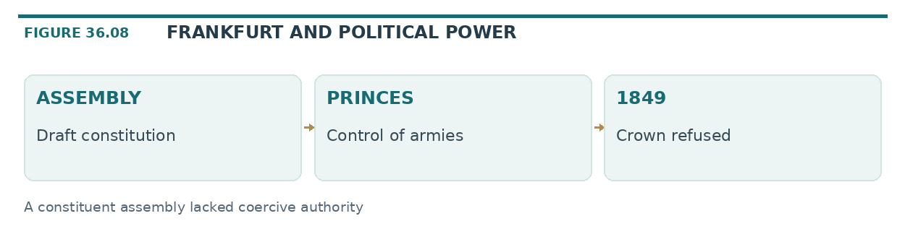

Delegates to the Frankfurt National Assembly met in 1848 to debate constitutional German unification. They disagreed over monarchy and republic, suffrage, the distribution of power between a central authority and member states, and whether an enlarged Germany could include Austrian territories. The 'Greater German' option faced the reality that Austrian rulers governed extensive non-German lands; the 'Lesser German' solution centered more clearly on Prussia. \[<a href="/036-nationalism-and-the-nineteenth-century-nation-state/sources/#source-8" class="cite">8</a>\]\[<a href="/036-nationalism-and-the-nineteenth-century-nation-state/sources/#source-12" class="cite">12</a>\]

The assembly drafted a constitution and in 1849 offered the imperial crown to Frederick William IV of Prussia, who rejected the proposed constitutional route. Its lack of independent coercive power, the resistance of major princes and changing revolutionary conditions fatally limited the experiment. The failure did not demonstrate that nationalism required dictatorship. It showed that political ideals without effective control of armies, finances and administrative institutions were vulnerable.

<figure class="figure" id="figure-36-8">

<figcaption>Figure 36.8. A constituent assembly lacked coercive authority. <a class="figure-anchor" href="#figure-36-8" aria-label="Link to this figure">#</a></figcaption>
</figure>

Later German unification under Prussian leadership is sometimes described as the triumph of 'blood and iron' over 'speeches and majority decisions.' That slogan obscures the real strength of earlier parliaments, civil societies and commercial networks, but it highlights a contrast between an attempted constitutional constituent assembly and later interstate military and diplomatic action. National unity could be created by rulers who had not wanted to concede parliamentary supremacy.
