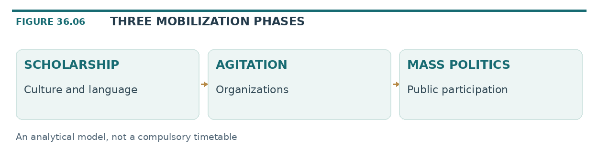

Hroch's comparative model describes phases through which some national movements moved: scholarly investigation of language and history; organized patriotic agitation; and broader mass participation. These are useful analytical categories, not a universal timetable. A movement may acquire popular energy before its scholars have settled linguistic standards, and governments can suppress agitation or transform its aims. The models should be tested against actual cases rather than applied mechanically. \[<a href="/036-nationalism-and-the-nineteenth-century-nation-state/sources/#source-5" class="cite">5</a>\]

A small circle of teachers and clergy might print textbooks and establish reading rooms; merchants could finance newspapers; lawyers might articulate constitutional claims; returning migrants might bring new political vocabularies. Some elites adopted nationalism because it offered wider representation and opportunities. Other elites feared losing privileges tied to imperial office, local autonomy or a cosmopolitan language. Political identity thus developed through bargaining as well as enthusiasm.

<figure class="figure" id="figure-36-6">

<figcaption>Figure 36.6. An analytical model, not a compulsory timetable. <a class="figure-anchor" href="#figure-36-6" aria-label="Link to this figure">#</a></figcaption>
</figure>

Imagine two adjacent districts where residents speak similar dialects but receive different schools, tax rules and newspapers. Over two generations they might come to identify with different political nations. Conversely, people speaking different languages might share a durable state patriotism. This does not mean all identities are interchangeable; it means political institutions can strengthen or weaken particular ways of belonging.
