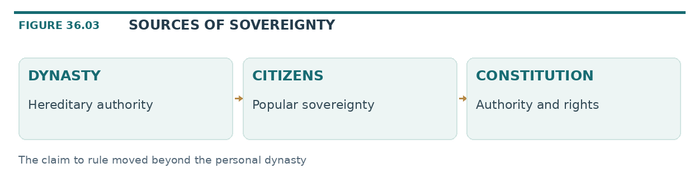

Before the nineteenth century, many rulers justified authority through dynasty, religion, hereditary law or territorial precedent. A Habsburg emperor, Bourbon king or Ottoman sultan governed people who spoke multiple languages. Political rights could be restricted by estate, property, religion or local privilege. Modern nationalists questioned why a ruler's family should determine the political fate of a people, although some were perfectly willing to place a national monarch on the throne once independence was won.

The American and French Revolutions challenged hereditary sovereignty in different ways. The French language of the <em>nation</em> as a source of political authority, and the conscription of citizens in mass armies, helped make national loyalty a matter of public life. Napoleon's campaigns then spread legal reforms and administrative changes while provoking resistance to French domination. People sometimes learned nationalism through the experience of being ruled by a foreign empire rather than through an abstract philosophical text. \[<a href="/036-nationalism-and-the-nineteenth-century-nation-state/sources/#source-7" class="cite">7</a>\]

<figure class="figure" id="figure-36-3">

<figcaption>Figure 36.3. The claim to rule moved beyond the personal dynasty. <a class="figure-anchor" href="#figure-36-3" aria-label="Link to this figure">#</a></figcaption>
</figure>

Nationalism and constitutional liberalism often became allies: both could oppose arbitrary dynastic rule. But they could also conflict. If 'the nation' were sovereign, who counted as a member? Would a language minority have equal civil rights? Were women, the poor or colonial subjects included? A nation might claim freedom from an empire while refusing it to neighboring peoples. These questions will recur throughout this chapter.
