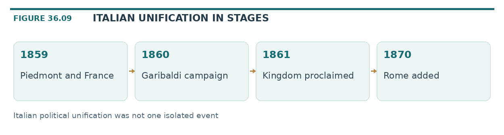

In 1860 Garibaldi led the Expedition of the Thousand to Sicily, where his volunteers challenged Bourbon rule. Their successes expanded into southern mainland Italy and helped collapse the Kingdom of the Two Sicilies. Garibaldi's revolutionary republican reputation created difficulties for conservative and moderate supporters of unity. Cavour and the Piedmontese monarchy moved to bring the south into a royal framework rather than allow an independent revolutionary regime to emerge. \[<a href="/036-nationalism-and-the-nineteenth-century-nation-state/sources/#source-13" class="cite">13</a>\]\[<a href="/036-nationalism-and-the-nineteenth-century-nation-state/sources/#source-14" class="cite">14</a>\]

In March 1861 the Kingdom of Italy was proclaimed under Victor Emmanuel II. Its territory was still incomplete by the standards of many nationalists: Venetia joined in 1866 and Rome in 1870 after French protection of the papal government weakened during the Franco-Prussian War. The process therefore had several milestones, not one moment when all Italians suddenly acquired the same citizenship and loyalties.

<figure class="figure" id="figure-36-9">

<figcaption>Figure 36.9. Italian political unification was not one isolated event. <a class="figure-anchor" href="#figure-36-9" aria-label="Link to this figure">#</a></figcaption>
</figure>

Statehood did not end division. Differences in taxation, regional administration, military service, landholding, poverty and dialect remained large. Resistance and brigandage in the south developed in a complicated context that included local loyalties, social distress, criminal networks and anti-state violence. Simplifying it as either a pure liberation struggle or mere criminality ignores those overlapping causes. <strong>Making Italy as a state did not automatically make an integrated Italian society.</strong>
