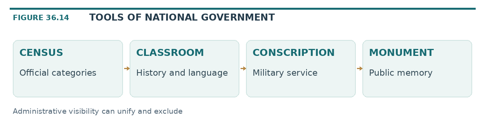

Modern states acquired stronger instruments for counting and organizing populations. Census schedules, identity papers, military registers, maps and statistical offices allowed officials to see society in more standardized categories. This could support public health, infrastructure and consistent administration. It could also put pressure on people whose forms of identity did not match official boxes or whose local languages were inconvenient for the center. \[<a href="/036-nationalism-and-the-nineteenth-century-nation-state/sources/#source-19" class="cite">19</a>\]\[<a href="/036-nationalism-and-the-nineteenth-century-nation-state/sources/#source-29" class="cite">29</a>\]

Conscription introduced many men to officers, regulations and peers from other districts. Standardized education taught national geography and shared historical narratives. National holidays and commemorations honored selected founders and battles. Monument construction turned public squares into statements of collective memory. These were not magical methods of unity; they could encounter resistance, produce boredom or become objects of competing interpretations.

<figure class="figure" id="figure-36-14">

<figcaption>Figure 36.14. Administrative visibility can unify and exclude. <a class="figure-anchor" href="#figure-36-14" aria-label="Link to this figure">#</a></figcaption>
</figure>

The sources require careful reading. A census that reports 100,000 speakers of one language may reflect the questions asked, the enumerators' practices and whether bilingual answers were permitted. A government school report can measure enrollment more reliably than how deeply pupils accepted its patriotic message. An army's oath reveals the ideals officials wanted recruits to follow, not necessarily what every recruit believed.
