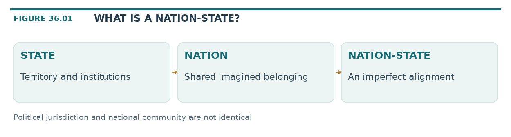

A <em>state</em> is a durable system of political institutions that claims governing authority over a territory and population. A <em>nation</em> is a community whose members consider themselves linked by some combination of history, political identity, culture, language, memories or shared destiny. A <em>nation-state</em> is an ideal in which the boundaries of political authority and national community are closely aligned. These are analytical definitions, not tests by which everyone agrees who belongs. States may contain several national communities; a nation may be spread across more than one state; a person may belong to several communities at once.

<em>Nationalism</em> is the broad family of claims that a nation deserves recognition, loyalty or political expression, often through self-government. It can be directed against foreign domination, support an existing state, call for cultural autonomy, or seek territorial expansion. A movement can describe itself as national while dividing over suffrage, religion, monarchy or economic inequality. Nationalism is neither simply love of a place nor automatically aggressive hostility toward outsiders; its political consequences depend on the goals pursued and the means accepted. \[<a href="/036-nationalism-and-the-nineteenth-century-nation-state/sources/#source-1" class="cite">1</a>\]\[<a href="/036-nationalism-and-the-nineteenth-century-nation-state/sources/#source-3" class="cite">3</a>\]

<figure class="figure" id="figure-36-1">

<figcaption>Figure 36.1. Political jurisdiction and national community are not identical. <a class="figure-anchor" href="#figure-36-1" aria-label="Link to this figure">#</a></figcaption>
</figure>

A useful starting distinction is between national identification—the feeling of belonging—and national programs—organized efforts to change law and government. Patriotism ordinarily refers to attachment to a political community or homeland, although everyday language overlaps. Ethnicity may include presumed descent, shared practices and historical memories, but ethnic categories themselves change. Race, as used in nineteenth-century politics, increasingly organized allegedly biological hierarchies that did not correspond to sound scientific categories. Avoid putting all these terms into one box.
