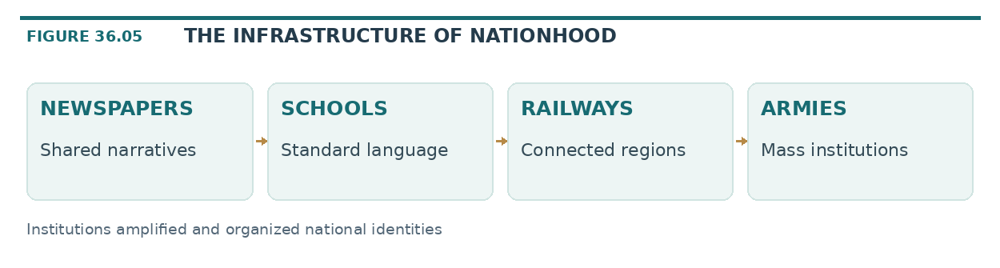

National movements became more influential when they could reach strangers. Expanding literacy, newspapers, cheap print, postal systems, railways and voluntary societies made distant political events feel connected. A reader of a provincial newspaper might learn that people in other towns debated the same reform or commemorated the same hero. Shared calendars, symbols and public ceremonies created repetition across space. Anderson's 'print capitalism' captures one important part of this process without suggesting that every newspaper reader became a nationalist. \[<a href="/036-nationalism-and-the-nineteenth-century-nation-state/sources/#source-2" class="cite">2</a>\]

Education mattered at least as much. Schools introduced standardized spelling, national histories, official geography and civic obligations. Teachers could bring a government's version of the nation into communities where ordinary conversation used another language. Military service and later mass electoral politics exposed people to national institutions, but the effect was not uniform: villagers might resist a school curriculum while still joining an army, or support regional autonomy while respecting state laws. \[<a href="/036-nationalism-and-the-nineteenth-century-nation-state/sources/#source-10" class="cite">10</a>\]

<figure class="figure" id="figure-36-5">

<figcaption>Figure 36.5. Institutions amplified and organized national identities. <a class="figure-anchor" href="#figure-36-5" aria-label="Link to this figure">#</a></figcaption>
</figure>

One must distinguish national schools run by existing states from clandestine or voluntary schools operated by movements seeking statehood. The first often aimed to make subjects into citizens of an established country; the second might seek to make a political nation visible before independence. Both show that nationalism was not just an emotion: it needed organizations, money, curricula, social networks and access to authority.
