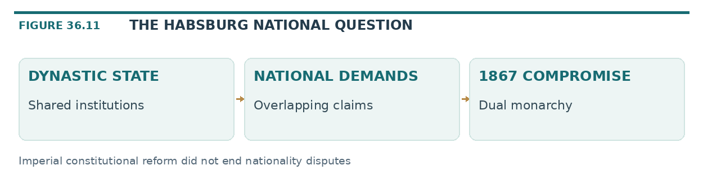

The Habsburg lands included German speakers, Hungarians, Czechs, Slovaks, Poles, Ruthenians/Ukrainians, Croats, Slovenes, Romanians, Italians, Serbs and others. Religious, regional and social divisions crossed language lines. The empire had traditions of dynastic loyalty, bureaucratic integration, elite negotiation and economic interdependence. Some subjects sought independence; others preferred constitutional autonomy within the monarchy. A historical account that assumes everyone wanted a sovereign ethnic state from the beginning misses much of the period. \[<a href="/036-nationalism-and-the-nineteenth-century-nation-state/sources/#source-17" class="cite">17</a>\]\[<a href="/036-nationalism-and-the-nineteenth-century-nation-state/sources/#source-18" class="cite">18</a>\]

The revolutions of 1848 exposed these competing plans. Hungarian leaders sought political autonomy or independence from Vienna but confronted the aspirations of non-Magyar populations within lands claimed by the Hungarian crown. Czech activists discussed federal or national rights without agreeing to absorption into a German nation. Croatian and other actors bargained with Vienna, Hungarian leaders and neighboring movements. The national question became difficult partly because several peoples claimed overlapping territories.

<figure class="figure" id="figure-36-11">

<figcaption>Figure 36.11. Imperial constitutional reform did not end nationality disputes. <a class="figure-anchor" href="#figure-36-11" aria-label="Link to this figure">#</a></figcaption>
</figure>

After military defeat by Prussia in 1866, the Habsburg regime made the Austro-Hungarian Compromise of 1867, creating a dual monarchy with separate Austrian and Hungarian governmental structures under one monarch and common institutions for certain affairs. The settlement elevated Hungarian political elites but left many other national demands unresolved. In the Austrian half, constitutional language rights and complex provincial politics allowed some accommodation. In the Hungarian half, Magyar language and administrative policies were contentious. Neither half was simply a static prison of nations. \[<a href="/036-nationalism-and-the-nineteenth-century-nation-state/sources/#source-17" class="cite">17</a>\]\[<a href="/036-nationalism-and-the-nineteenth-century-nation-state/sources/#source-19" class="cite">19</a>\]
