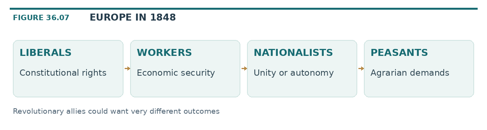

Revolutions erupted across much of Europe in 1848 amid economic distress, demands for constitutions, hostility toward conservative governments, and nationalist ambitions. In France the July Monarchy fell and a republic was established. In the German lands, liberal assemblies and public demonstrations pressed for reform and unity. In the Habsburg monarchy, revolutionaries challenged imperial administration while Czechs, Hungarians, Italians, Croats and others advanced partly competing demands. \[<a href="/036-nationalism-and-the-nineteenth-century-nation-state/sources/#source-11" class="cite">11</a>\]

The uprisings were not one coordinated revolution. Urban workers feared unemployment, professionals wanted constitutional guarantees, peasants often focused on feudal dues and land obligations, and national activists disputed borders and language rights. A demand for national liberation by one community could alarm another community living in the same region. Habsburg authorities exploited some of these divisions, but the conflicts were also rooted in genuine disagreements about representation and political survival.

<figure class="figure" id="figure-36-7">

<figcaption>Figure 36.7. Revolutionary allies could want very different outcomes. <a class="figure-anchor" href="#figure-36-7" aria-label="Link to this figure">#</a></figcaption>
</figure>

Many revolutions were defeated or contained by 1849. Yet their apparent failure concealed long-term effects: the abolition of many remaining peasant obligations in Habsburg lands, experience with representative institutions, public nationalist mobilization and enduring symbolic memories. Historians should not infer from a crushed uprising that it changed nothing. Its participants may have lost control of government while changing the language of legitimacy.
