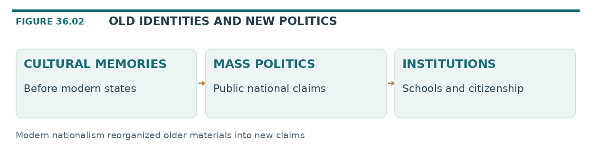

People had long spoken languages, worshipped in shared traditions, remembered wars and recognized collective names. Claims of English, French, Polish, Greek or Chinese belonging predate industrial society. The nineteenth century did not invent every historical community from nothing. What changed dramatically was the political idea that a nation should be a principal source of sovereignty and that a state should teach citizens to recognize one shared national history. Scholars disagree about how much continuity separates older loyalties from modern mass nationalism. \[<a href="/036-nationalism-and-the-nineteenth-century-nation-state/sources/#source-1" class="cite">1</a>\]\[<a href="/036-nationalism-and-the-nineteenth-century-nation-state/sources/#source-4" class="cite">4</a>\]

Benedict Anderson emphasized communities imagined by people who will never meet most of their fellow members. Eric Hobsbawm examined modern political uses of national history and invented or refashioned traditions. Miroslav Hroch studied how cultural research, patriotic agitation and wider political mobilization interacted among smaller European nations. These approaches illuminate mechanisms; none means that national feeling is necessarily fake. The fact that a festival's present form is recent does not prove its participants experience it insincerely. \[<a href="/036-nationalism-and-the-nineteenth-century-nation-state/sources/#source-2" class="cite">2</a>\]\[<a href="/036-nationalism-and-the-nineteenth-century-nation-state/sources/#source-5" class="cite">5</a>\]\[<a href="/036-nationalism-and-the-nineteenth-century-nation-state/sources/#source-6" class="cite">6</a>\]

<figure class="figure" id="figure-36-2">

<figcaption>Figure 36.2. Modern nationalism reorganized older materials into new claims. <a class="figure-anchor" href="#figure-36-2" aria-label="Link to this figure">#</a></figcaption>
</figure>

Historical language matters here. A writer in 1800 might call people a 'nation' without demanding independent statehood. A peasant might describe a locality, religion and monarch rather than a modern citizenship status. A map's ethnic labels sometimes reflect the mapmaker's classification rather than the identity people would use themselves. The historian must ask who used an identity, to what audience, and with what political consequences.
