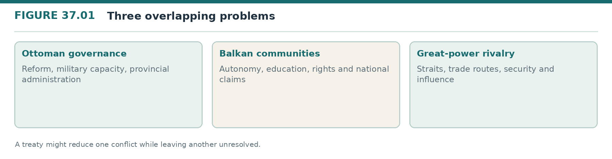

Before examining national movements, remove the imagined emptiness from the map. Ottoman southeastern Europe contained villages of cultivators and pastoralists, ports and market towns, monasteries, mosques, churches, synagogues, schools, craft guilds and trading networks. Orthodox Christians formed important communities, but so did Muslims, Catholics, Jews and people of varied regional and linguistic backgrounds. Albanians included both Muslims and Christians; Slavic-speaking populations also differed by religion and political loyalty. A town could be multilingual in commerce even where a village was more linguistically homogeneous.

Ottoman officials worked through a mix of centrally appointed officers, tax collectors, courts, religious authorities, military institutions and local elites. They were not equally effective everywhere. The term millet is often used casually to imply fixed national communities, but Ottoman arrangements organized religious and legal authority in ways that changed over time; they were not equivalent to modern ethnic nations. Local identity might be expressed through confession, village, occupation, family, language or attachment to a dynasty, rather than a single national category.

This matters when reading maps produced after 1850. A cartographer could assign the same mixed district to a 'Greek,' 'Bulgarian,' 'Serbian' or 'Albanian' area depending on whether language, ecclesiastical allegiance, school attendance or political preference was treated as decisive. None of these indicators is a perfect proxy for the others. National movements did not invent local traditions, but they reorganized them into claims that a distinct people should have a state. \[<a href="/037-the-balkans-and-the-eastern-question/sources/#source-3" class="cite">3</a>\]\[<a href="/037-the-balkans-and-the-eastern-question/sources/#source-4" class="cite">4</a>\]

<figure class="figure" id="figure-37-1">

<figcaption>Figure 37.1. Political problems overlapped rather than appearing in one simple succession. <a class="figure-anchor" href="#figure-37-1" aria-label="Link to this figure">#</a></figcaption>
</figure>
