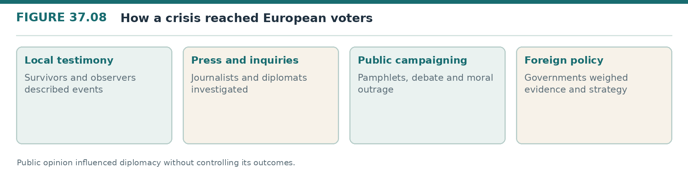

Bulgarian revolutionary committees planned an uprising in 1876. The April Uprising broke out in several districts, though participation, military preparation and outcomes varied widely. Ottoman forces and irregular troops suppressed it with extreme violence, including the killing of civilians. Batak became one of the best-known sites of atrocity. The suffering galvanized Bulgarian national memory and triggered international investigation and protest.

Accounts of casualty totals and descriptions of particular incidents must be handled carefully. Contemporary journalists, diplomats, survivors and later national historians did not all write with the same purposes or access to information. A responsible chapter neither minimizes documented mass violence because figures differ nor repeats every dramatic number as established fact. Distinguish the occurrence of atrocities, which is amply supported, from exact demographic claims that require separate verification.

There is also an ethical obligation to include the ordinary people whose experiences disappear when the story becomes only a competition between nations. Bulgarian civilians experienced terror and destruction; Muslim civilians in the wider cycle of warfare and retaliation also suffered, and later population movements affected both groups. Recognizing more than one victim population does not obscure who committed particular acts. \[<a href="/037-the-balkans-and-the-eastern-question/sources/#source-14" class="cite">14</a>\]\[<a href="/037-the-balkans-and-the-eastern-question/sources/#source-22" class="cite">22</a>\]

<figure class="figure" id="figure-37-8">

<figcaption>Figure 37.8. Investigation, publicity and diplomacy interacted during the 1876 crisis. <a class="figure-anchor" href="#figure-37-8" aria-label="Link to this figure">#</a></figcaption>
</figure>
