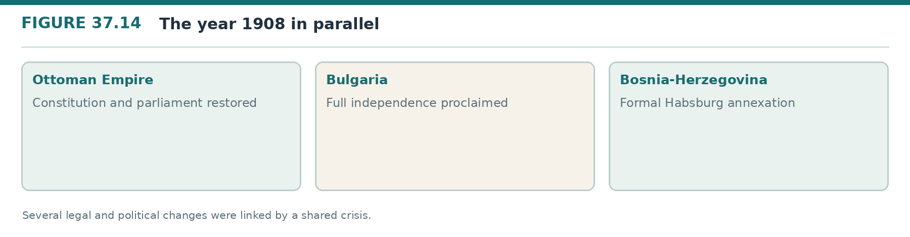

The Treaty of Berlin authorized Austria-Hungary to occupy and administer Bosnia and Herzegovina in 1878, even though the territory formally remained under Ottoman sovereignty. The military occupation met resistance, including among Muslims and others who opposed Habsburg intervention. The subsequent administration reorganized parts of the provincial bureaucracy, transport, policing, education and finance, while navigating tensions among Muslim, Orthodox and Catholic communities.

Habsburg officials hoped the territory would be governable without simply becoming a platform for Serbian or Croatian national projects. Their policies included attempts to cultivate a wider Bosnian territorial identity, but the population's allegiances remained contested. One can identify material improvements to infrastructure without concluding that occupation was voluntary or legitimate in the eyes of every resident. Likewise, nationalist opposition should not be treated as unanimous across all groups.

In 1908 Austria-Hungary formally annexed Bosnia and Herzegovina, prompting a severe diplomatic crisis. Serbia protested; Russia was weakened after the Russo-Japanese War and the revolution of 1905; Germany supported its ally Austria-Hungary. The crisis was resolved without European war, but it aggravated distrust. In 1914 Sarajevo—under Habsburg rule—became the setting of an assassination that triggered a much wider confrontation. \[<a href="/037-the-balkans-and-the-eastern-question/sources/#source-2" class="cite">2</a>\]\[<a href="/037-the-balkans-and-the-eastern-question/sources/#source-21" class="cite">21</a>\]

<figure class="figure" id="figure-37-14">

<figcaption>Figure 37.14. The political transformations of 1908 were interconnected. <a class="figure-anchor" href="#figure-37-14" aria-label="Link to this figure">#</a></figcaption>
</figure>
