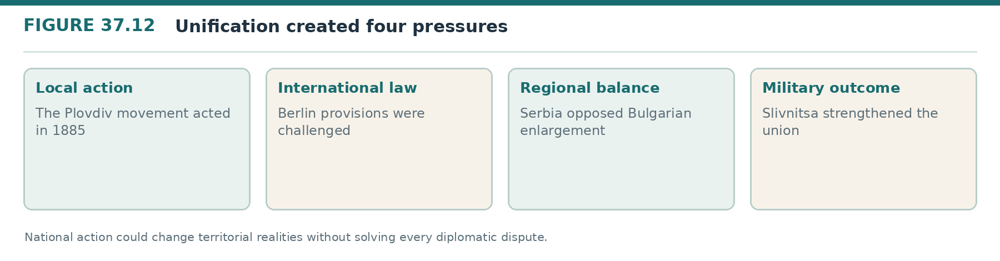

Eastern Rumelia, with its administrative center at Plovdiv, was formally an autonomous Ottoman province under a Christian governor-general. Its institutions and schools created a political setting different from the Ottoman provinces left under more direct central rule. Bulgarian activists pursued union with the northern principality, while the authorities and foreign powers debated how the Berlin settlement would be upheld.

In September 1885, a movement in Plovdiv overthrew the provincial government and proclaimed union with the Bulgarian principality. Prince Alexander accepted the union. The resulting crisis showed that the settlement of 1878 was not permanent simply because the great powers had signed it. Ottoman and European reactions were conditioned by the danger of a wider war and by rival calculations. The eventual diplomatic accommodation recognized the new reality without initially erasing every legal fiction of the older order.

In Bulgarian public memory, Unification often appears as a moment of bold national action, and with reason. But it should also be studied as a case of constitutional change and diplomatic improvisation. What were the legal costs of violating an international treaty? What gave the union popular authority? How did neighboring states assess the precedent? The same action could be celebrated as self-determination by one nation and feared as destabilization by another. \[<a href="/037-the-balkans-and-the-eastern-question/sources/#source-1" class="cite">1</a>\]\[<a href="/037-the-balkans-and-the-eastern-question/sources/#source-29" class="cite">29</a>\]

<figure class="figure" id="figure-37-12">

<figcaption>Figure 37.12. The Unification of 1885 changed facts on the ground and regional diplomacy. <a class="figure-anchor" href="#figure-37-12" aria-label="Link to this figure">#</a></figcaption>
</figure>
