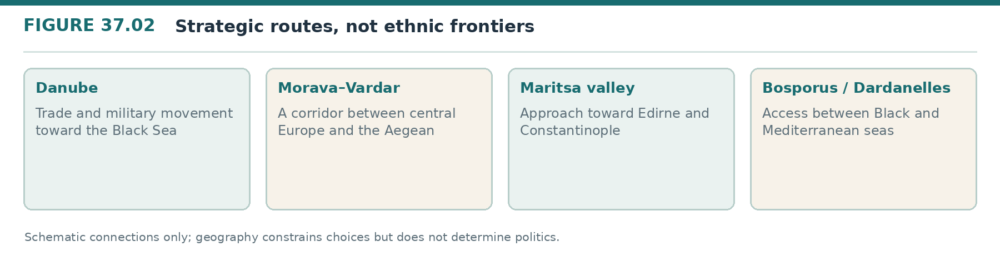

The Balkans were strategically important partly because geography constrained movement. The Danube connected the European interior with the Black Sea and supplied a route for grain, commerce and armies. Mountain chains—including the Balkan Mountains, Rhodopes, Dinaric ranges and Pindus—created local barriers while particular passes became points of military importance. The Morava–Vardar corridor connected central Europe toward Thessaloniki; the Maritsa valley offered another path toward Edirne and Constantinople. The Adriatic, Aegean and Black Sea opened different maritime directions.

For Russia, Black Sea access and the Bosporus and Dardanelles had implications for naval and commercial movement. For Britain, a potentially dominant Russian position near the eastern Mediterranean raised concerns for naval strategy and routes toward India, especially after the Suez Canal opened in 1869. Austria-Hungary examined routes toward Bosnia, the Adriatic and the central Balkan interior; the prospect of nationalist agitation among its own South Slavs intensified its calculations. Italy also developed Adriatic interests after unification.

Geography did not automatically dictate policy. The same port could be a commercial opportunity for merchants and a strategic vulnerability for diplomats. A map of mountains and straits therefore helps us identify constraints, not predetermine outcomes. Always ask who controls a passage, who actually lives beside it and who can supply the troops intended to hold it. \[<a href="/037-the-balkans-and-the-eastern-question/sources/#source-2" class="cite">2</a>\]\[<a href="/037-the-balkans-and-the-eastern-question/sources/#source-5" class="cite">5</a>\]

<figure class="figure" id="figure-37-2">

<figcaption>Figure 37.2. Waterways and corridors created strategic connections, not natural national borders. <a class="figure-anchor" href="#figure-37-2" aria-label="Link to this figure">#</a></figcaption>
</figure>
