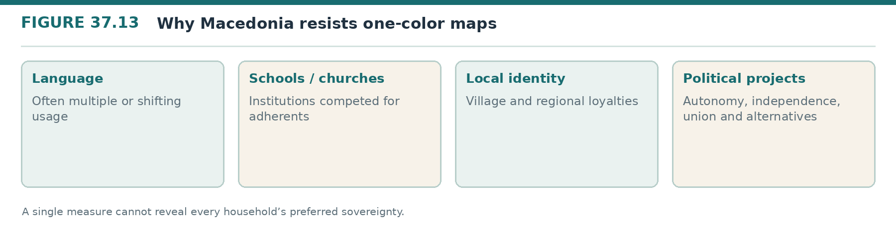

Ottoman Macedonia was not one modern state with a universally accepted boundary. Historians use the term for a broad geographical and historical region, while Ottoman administrative districts did not match every later national map. Towns, mountains and valleys contained populations who differed by language, religion, school and church affiliation, local loyalties and political aspirations. Jews were a substantial part of Salonika's urban society; Muslims included Turkish-, Albanian-, Slavic- and other speaking communities; Orthodox Christians could have competing institutional attachments.

Bulgarian, Greek and Serbian national movements created schools, churches, newspapers, armed groups and diplomatic campaigns that sought influence. Exarchist–Patriarchist competition sometimes became an index of national allegiance, but it did not convert every household into a fixed national category. Some activists favored autonomy or federation; others promoted union with neighboring states. The Internal Macedonian Revolutionary Organization and related networks changed over time, and their aims and memberships should not be flattened into one continuous program.

Modern Bulgarian, Greek and North Macedonian national narratives often assign different meanings to nineteenth-century individuals and movements. A careful history identifies what a person said in a particular document, when it was written, and which identities were available in that context. It avoids retroactively using a twenty-first-century census category as proof of how an entire nineteenth-century village understood itself. \[<a href="/037-the-balkans-and-the-eastern-question/sources/#source-4" class="cite">4</a>\]\[<a href="/037-the-balkans-and-the-eastern-question/sources/#source-30" class="cite">30</a>\]

<figure class="figure" id="figure-37-13">

<figcaption>Figure 37.13. No single demographic indicator captures the complexity of Macedonia. <a class="figure-anchor" href="#figure-37-13" aria-label="Link to this figure">#</a></figcaption>
</figure>
