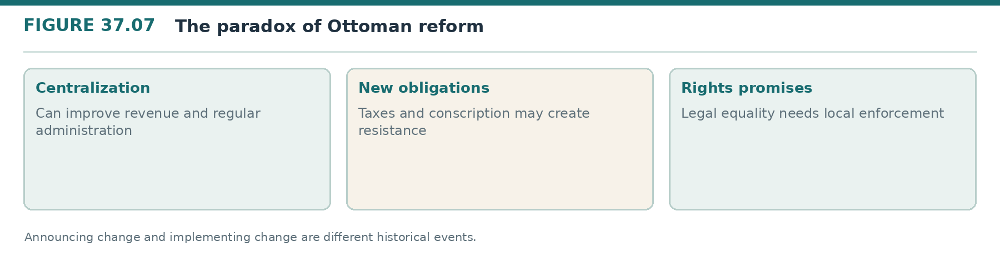

The Tanzimat reforms, conventionally dated from 1839 to 1876, attempted to improve administration, reorganize military and fiscal institutions and redefine the legal status of subjects. Reform decrees and new laws promised forms of security and equality that were significant departures from older arrangements. Centralization, provincial councils, standardized regulations, new schools and improved communications expanded state capacity unevenly.

Reform could create new tensions. Muslim communities sometimes feared losing established advantages, while Christian subjects might welcome legal promises but remain skeptical when officials failed to implement them. Local elites resisted measures that threatened their authority. An Ottoman government's ability to announce equality exceeded its capacity to enforce equal treatment in every village. Moreover, expanded conscription, new taxes and stronger policing could feel less like liberation than intrusion.

In 1876 reform-minded politicians helped introduce the first Ottoman constitution and parliament, a development closely connected to the crisis of that year. Sultan Abdülhamid II suspended parliament in 1878. This sequence demonstrates that constitutional politics and imperial survival were intertwined. Ottoman history did not simply move from unchanged despotism to collapse; it contained substantial reform programs whose aims and consequences were contested. \[<a href="/037-the-balkans-and-the-eastern-question/sources/#source-3" class="cite">3</a>\]\[<a href="/037-the-balkans-and-the-eastern-question/sources/#source-7" class="cite">7</a>\]

<figure class="figure" id="figure-37-7">

<figcaption>Figure 37.7. Ottoman reform created new capacities and new tensions. <a class="figure-anchor" href="#figure-37-7" aria-label="Link to this figure">#</a></figcaption>
</figure>
