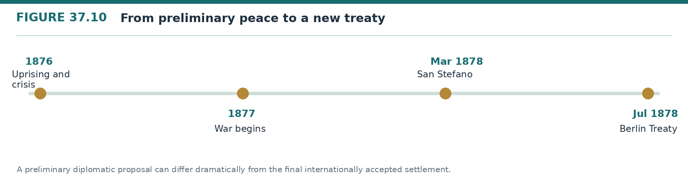

The preliminary Treaty of San Stefano, signed on 3 March 1878 in the modern Gregorian calendar, proposed a large autonomous Bulgarian principality under Ottoman suzerainty, with territory extending into parts of Macedonia and Thrace. Its projected geography was central to later Bulgarian national imagination. The agreement followed military victory, but it was not a universally accepted final peace. Its terms also addressed Serbia, Montenegro, Romania and Russian territorial gains.

A crucial analytical distinction: the projected borders of San Stefano were a diplomatic design, not an achieved census of national preference. Within the envisaged principality lived people with varied languages, religions and political affiliations. Some inhabitants welcomed a Bulgarian state; others feared the new arrangement or claimed other political futures. The lines therefore should not be presented as proof that every settlement within them belonged culturally or politically to one nation.

Britain and Austria-Hungary feared that an enlarged Bulgarian state might become an instrument of Russian influence, threatening the regional balance of power. Russia too had to consider the risk of a broader conflict with other European states. For these reasons the settlement was revised at the Congress of Berlin. The gap between San Stefano's projected map and the subsequent treaty became a durable source of Bulgarian grievance, often summarized in national remembrance as the division of Bulgarian lands. \[<a href="/037-the-balkans-and-the-eastern-question/sources/#source-1" class="cite">1</a>\]\[<a href="/037-the-balkans-and-the-eastern-question/sources/#source-26" class="cite">26</a>\]

<figure class="figure" id="figure-37-10">

<figcaption>Figure 37.10. San Stefano and Berlin marked different stages of one diplomatic crisis. <a class="figure-anchor" href="#figure-37-10" aria-label="Link to this figure">#</a></figcaption>
</figure>
