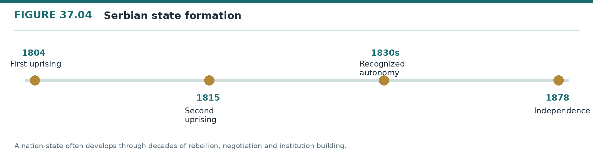

The First Serbian Uprising began in 1804 against local Janissary abuses and developed into a broader challenge to Ottoman rule. Karađorđe became a prominent leader. An Ottoman reconquest in 1813 interrupted the movement, but a second uprising in 1815, associated with Miloš Obrenović, opened a more durable route to self-government. Through negotiation, local political consolidation and shifts in the international balance, the Serbian principality gained increasing autonomy during the 1820s and 1830s. Its full independence was internationally recognized at Berlin in 1878.

The trajectory shows that national independence can be a long series of arrangements rather than one victorious battle. Serbian rulers competed with one another, built courts and schools, sought taxation and military capacity, and contested constitutional limits on dynastic authority. Serbia also maintained claims and sympathies beyond its existing frontier, a fact that would later affect relations with Ottoman provinces and Austria-Hungary.

Serbian history cannot be understood by treating every Orthodox Slavic speaker as an unquestioned member of one political nation. Identities and loyalties varied, particularly in Bosnia, Kosovo and Macedonia. A useful comparison with Greece and Bulgaria is the degree to which each movement combined peasant rebellion, religious institutions, outside intervention and eventual state building. \[<a href="/037-the-balkans-and-the-eastern-question/sources/#source-8" class="cite">8</a>\]\[<a href="/037-the-balkans-and-the-eastern-question/sources/#source-9" class="cite">9</a>\]

<figure class="figure" id="figure-37-4">

<figcaption>Figure 37.4. Autonomy and internationally recognized independence were different stages. <a class="figure-anchor" href="#figure-37-4" aria-label="Link to this figure">#</a></figcaption>
</figure>
