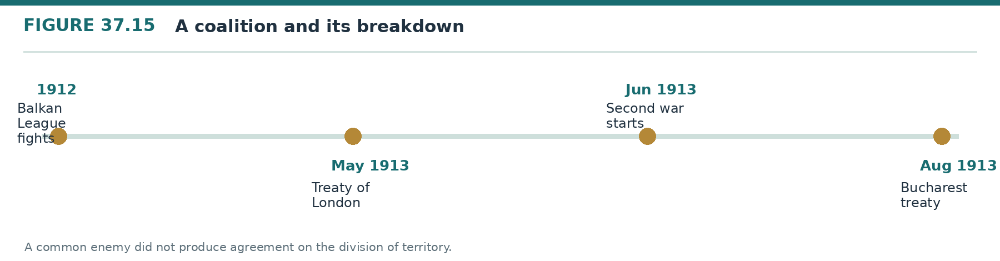

By 1912 the Ottoman Empire faced Italian military action in Libya, Albanian unrest and persistent tension in its European provinces. Bulgaria, Serbia, Greece and Montenegro formed the Balkan League through related agreements and attacked the Ottoman Empire in the autumn of 1912. Their coalition was effective against Ottoman forces, though the allies pursued objectives that were not fully compatible. Bulgarian armies fought major campaigns in Thrace, Serbian forces advanced into Macedonia, and Greek forces took Thessaloniki. Montenegro fought in the west.

The First Balkan War drastically reduced Ottoman territorial control in Europe. Peace negotiations produced the Treaty of London in May 1913, but the allies still disputed how territory should be allocated. Military occupation did not automatically settle legal sovereignty or popular consent. Each government could claim that its sacrifices, treaties or national history justified particular territories. Macedonia and access to the Aegean became especially contested.

Do not narrate this war merely as the liberation of Christians from an empire. Many inhabitants experienced military violence and displacement; Muslim civilians were especially vulnerable in several theaters, while some Christian communities welcomed approaching troops and others feared a new administration. The alliance's short life shows how a coalition united by a common enemy can break apart once victory requires dividing the gains. \[<a href="/037-the-balkans-and-the-eastern-question/sources/#source-4" class="cite">4</a>\]\[<a href="/037-the-balkans-and-the-eastern-question/sources/#source-31" class="cite">31</a>\]

<figure class="figure" id="figure-37-15">

<figcaption>Figure 37.15. Victory over a common enemy did not settle territorial disagreements. <a class="figure-anchor" href="#figure-37-15" aria-label="Link to this figure">#</a></figcaption>
</figure>
