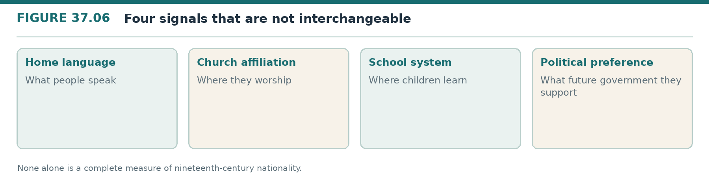

One central Bulgarian demand concerned the ability to worship and be educated under a Bulgarian ecclesiastical hierarchy rather than Greek-speaking institutions of the Ecumenical Patriarchate. A sultanic decree in 1870 established the Bulgarian Exarchate. Its jurisdiction involved rules for particular dioceses and, under specified conditions, locally expressed preferences. The question was not simply theological: schools, appointments, worship language, communal resources and symbolic representation were at stake.

In some areas, church affiliation became an indicator used by national committees and outsiders to classify a population. Competition between Exarchate and Patriarchate institutions could express Bulgarian and Greek political projects, especially in contested districts. The Patriarchate did not represent every Greek-speaking person in the same political way, and the Exarchate was not a perfect census of Bulgarian nationality. Religious divisions could also intensify personal rivalries over schools, churches and land.

The Exarchate is best understood as both a cultural institution and a political resource. It helped create a space for education and administration before a Bulgarian state existed, but it also operated within Ottoman structures and faced dilemmas once the 1878 settlement divided territories associated with Bulgarian national aspirations. \[<a href="/037-the-balkans-and-the-eastern-question/sources/#source-13" class="cite">13</a>\]\[<a href="/037-the-balkans-and-the-eastern-question/sources/#source-15" class="cite">15</a>\]

<figure class="figure" id="figure-37-6">

<figcaption>Figure 37.6. Institutions and language should not be confused with a complete ethnic census. <a class="figure-anchor" href="#figure-37-6" aria-label="Link to this figure">#</a></figcaption>
</figure>
