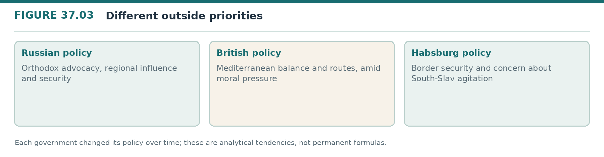

Russia combined several motives: strategic interests in the Black Sea and Straits, rivalry with other empires, sympathy for Orthodox Christian communities, and domestic Pan-Slav sentiment, whose influence varied by period. It was not simply an altruistic protector nor a power whose every action was reducible to warm-water ports. Britain often valued the preservation of a workable Ottoman state as a barrier to destabilizing expansion, but British responses also shifted under pressure from reports of violence and humanitarian agitation. France, Austria-Hungary and Germany had their own changing interests; Germany's Chancellor Bismarck sought to manage European relationships while avoiding a major conflict that might threaten his new empire.

The language of a 'Concert of Europe' described habits of great-power consultation that developed after Napoleon. Concert diplomacy helped manage some crises, but the participating states were unequal, and smaller peoples were rarely given comparable authority in negotiations. Great powers disagreed over what counted as legitimate national self-determination or a tolerable redistribution of power. Their cooperation was therefore conditional.

A useful method is to separate publicly declared principles from choices on the ground. A statesman might endorse religious freedom while supporting military occupation; another might praise national liberation while seeking a client government. Political motives were frequently mixed. Policy could be simultaneously strategic, ideological, economic and responsive to public opinion. \[<a href="/037-the-balkans-and-the-eastern-question/sources/#source-2" class="cite">2</a>\]\[<a href="/037-the-balkans-and-the-eastern-question/sources/#source-6" class="cite">6</a>\]

<figure class="figure" id="figure-37-3">

<figcaption>Figure 37.3. Great-power priorities changed over time and could be internally contradictory. <a class="figure-anchor" href="#figure-37-3" aria-label="Link to this figure">#</a></figcaption>
</figure>
