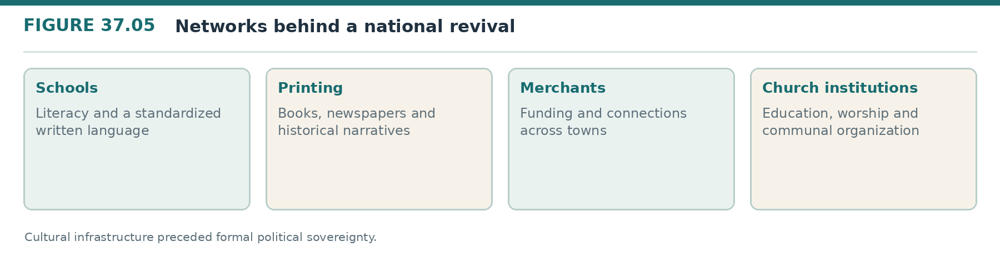

Wallachia and Moldavia enjoyed distinctive institutions under Ottoman suzerainty, shaped also by Russian influence and periodic foreign occupations. Their leaders and intellectuals took part in the revolutionary politics of 1848, though those movements were suppressed. After the Crimean War, diplomatic arrangements opened the path to union. In 1859 both principalities elected Alexandru Ioan Cuza, creating a de facto political union that was subsequently consolidated. The state adopted the name Romania, with constitutional changes and eventually a monarchy under Carol I.

The Danube mattered economically as well as politically. Grain exports, navigation rules, customs, ports and river commissions involved both Romanian politicians and neighboring powers. Romania fought alongside Russia in the 1877–1878 war and was recognized as independent by the Treaty of Berlin. Yet its territorial settlement was complicated: southern Bessarabia passed to Russia, while Romania received northern Dobruja. The arrangements involved local communities whose political preferences did not neatly match diplomatic exchange.

The Romanian case warns against describing national unification as the disappearance of external power. Romania's leaders built institutions while maneuvering between Istanbul, Saint Petersburg, Vienna and other capitals. Independence also raised contested questions about minorities, property, citizenship and inclusion. \[<a href="/037-the-balkans-and-the-eastern-question/sources/#source-11" class="cite">11</a>\]\[<a href="/037-the-balkans-and-the-eastern-question/sources/#source-12" class="cite">12</a>\]

<figure class="figure" id="figure-37-5">

<figcaption>Figure 37.5. Cultural networks helped sustain political ideas before a state existed. <a class="figure-anchor" href="#figure-37-5" aria-label="Link to this figure">#</a></figcaption>
</figure>
