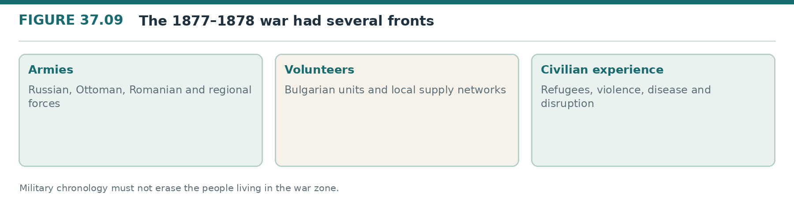

Russian forces crossed the Danube in 1877 and advanced through northern Bulgaria. Ottoman resistance at Plevna (Pleven), led by Osman Pasha, slowed the campaign and imposed heavy casualties. A prolonged siege succeeded only after further operations and the commitment of allied Romanian forces. In the Balkan Mountains, battles around the Shipka Pass became important both militarily and in Bulgarian historical memory. The war continued through winter operations, eventually bringing Russian forces close to Constantinople.

The campaign was not a simple movement of armies through empty territory. Soldiers required ammunition, food, horses and routes fit for artillery; winter weather challenged operations; civilians fled fighting or became exposed to reprisals and disease. Bulgarian volunteers, commonly called the opalchentsi, participated alongside Russian forces. Serbian and Montenegrin campaigns and Romanian participation must be counted as parts of the wider military and diplomatic setting rather than appendices to a single national liberation story.

Violence against civilians included attacks on Muslim populations and displacement alongside the earlier repression of Bulgarian Christians. Historians distinguish battlefield losses, refugees, forced expulsion and civilian deaths; these categories should not be merged into one impressive but unsupported figure. For the region's communities, liberation, defeat, survival and exile could occur within the same war, depending on where a family lived and what political identity it was assigned. \[<a href="/037-the-balkans-and-the-eastern-question/sources/#source-24" class="cite">24</a>\]\[<a href="/037-the-balkans-and-the-eastern-question/sources/#source-25" class="cite">25</a>\]

<figure class="figure" id="figure-37-9">

<figcaption>Figure 37.9. The war was experienced by soldiers and civilians alike. <a class="figure-anchor" href="#figure-37-9" aria-label="Link to this figure">#</a></figcaption>
</figure>
