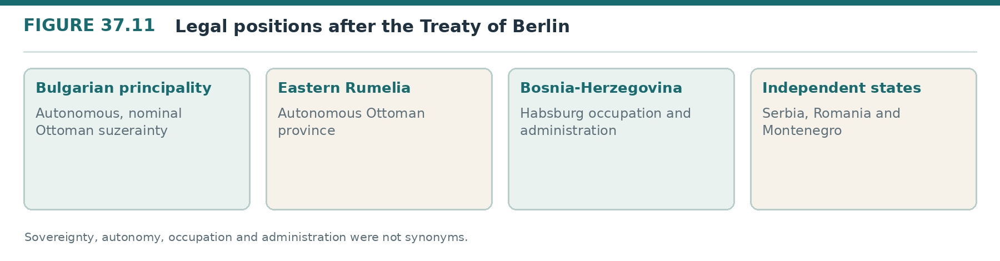

The Treaty of Berlin was signed on 13 July 1878. It reduced the size of the Bulgarian principality projected at San Stefano and separated Eastern Rumelia, which was established as an autonomous province under the Ottoman sultan's political and military authority. Macedonia and much of Thrace remained under more direct Ottoman rule. Serbia, Montenegro and Romania gained international recognition of independence, with territorial adjustments and conditions involving rights and property. Austria-Hungary received authority to occupy and administer Bosnia and Herzegovina while Ottoman sovereignty formally continued. Britain arranged separately to administer Cyprus under the Cyprus Convention of 1878.

The treaty did not bring a tidy end to imperial overlap. 'Independent,' 'autonomous,' 'occupied,' 'administered' and 'under suzerainty' were different legal positions, with different consequences for taxation, foreign policy and military affairs. A diagram of the settlement should distinguish actual government from formal claims. Bulgaria was not yet a wholly independent kingdom in 1878; Eastern Rumelia was not legally annexed to the principality; Bosnia and Herzegovina were not formally annexed by Austria-Hungary until 1908.

The treaty contained provisions related to religious liberty and the rights of inhabitants, yet the extent to which they protected vulnerable communities was uneven. Its central achievement was temporary management of major-power rivalry. Its central weakness was leaving powerful national claims dissatisfied, especially in Macedonia and adjacent regions. \[<a href="/037-the-balkans-and-the-eastern-question/sources/#source-1" class="cite">1</a>\]\[<a href="/037-the-balkans-and-the-eastern-question/sources/#source-27" class="cite">27</a>\]

<figure class="figure" id="figure-37-11">

<figcaption>Figure 37.11. Distinct legal regimes remained on the Balkan map after Berlin. <a class="figure-anchor" href="#figure-37-11" aria-label="Link to this figure">#</a></figcaption>
</figure>
