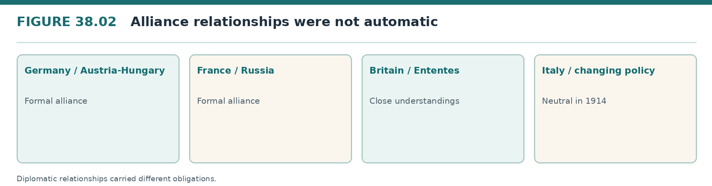

The pre-war diplomatic alignment is often simplified into two rigid blocks. Germany and Austria-Hungary were linked by an alliance, while France and Russia had a military alliance. Britain developed closer relationships with France and Russia through the Entente Cordiale and the Anglo-Russian Convention, but these were not identical to a single treaty compelling Britain to go to war over every eastern European conflict. Italy belonged formally to the Triple Alliance yet remained neutral in 1914 and later fought against Austria-Hungary. Ottoman and Bulgarian participation followed separate calculations in 1914 and 1915.

Alliances were designed partly to deter attack, but they could also make leaders overconfident or fearful. Austria-Hungary might believe German support reduced the danger of confronting Serbia; Russia might fear that abandoning Serbia would ruin its regional position. German planners feared a two-front war with France and Russia. The result was a system in which the same promise that reassured one state could alarm another. Alliances were not rails on which trains inevitably ran: they were political relationships interpreted and acted upon by governments. \[<a href="/038-world-war-i-causes-and-consequences/sources/#source-2" class="cite">2</a>\]\[<a href="/038-world-war-i-causes-and-consequences/sources/#source-5" class="cite">5</a>\]

<figure class="figure" id="figure-38-2">

<figcaption>Figure 38.2. Alliance relationships were not automatic <a class="figure-anchor" href="#figure-38-2" aria-label="Link to this figure">#</a></figcaption>
</figure>
