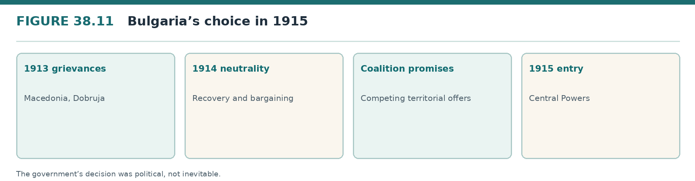

Bulgaria entered the twentieth century after a series of political transformations: the 1878 settlement, unification in 1885, full independence in 1908 and the Balkan Wars of 1912–1913. The Second Balkan War left Bulgaria defeated and dissatisfied with the division of Macedonia and with the loss of Southern Dobruja to Romania. These territorial grievances shaped diplomatic bargaining in 1914–1915, but they did not mechanically determine the choice of coalition. Bulgarian leaders knew their state was exhausted by recent fighting and initially maintained neutrality.

The opposing alliances offered different possibilities. The Central Powers could promise territory in Serbia, especially Vardar Macedonia, while the Entente confronted the competing claims of Serbia, Greece and Romania, each a potential or actual partner. Bulgaria's government, King Ferdinand, military leaders and political opposition did not form one unquestioning voice. Prime Minister Vasil Radoslavov's government eventually aligned with Germany and Austria-Hungary. To understand that decision, distinguish the population's suffering and hopes from the strategic calculations made by the rulers who committed the country to war. \[<a href="/038-world-war-i-causes-and-consequences/sources/#source-25" class="cite">25</a>\]\[<a href="/038-world-war-i-causes-and-consequences/sources/#source-26" class="cite">26</a>\]

<figure class="figure" id="figure-38-11">

<figcaption>Figure 38.11. Bulgaria’s choice in 1915 <a class="figure-anchor" href="#figure-38-11" aria-label="Link to this figure">#</a></figcaption>
</figure>
