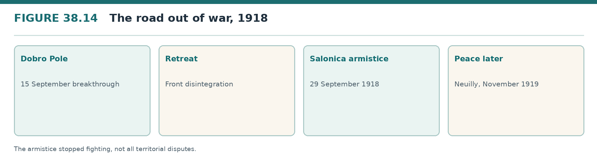

On 15 September 1918 Allied forces, including major Serbian and French formations, attacked positions on the Macedonian Front in the Dobro Pole sector. They broke through a part of the Bulgarian defense in difficult terrain. The rupture became a wider crisis as exhausted troops retreated and command struggled to organize a sustainable new line. Some Bulgarian units elsewhere, notably in the Doiran region, fought effectively, but local resistance could not reverse the strategic collapse. Events rapidly undermined the government's ability to continue the war.

Retreating soldiers joined unrest that contributed to the Radomir uprising; political crisis accelerated. Bulgaria sought an armistice, signed at Salonika on 29 September 1918, making it the first Central Power to leave the war. King Ferdinand abdicated in early October in favor of Boris III. The armistice did not settle Bulgaria's final borders. It terminated military participation under Allied terms and opened a difficult struggle over political responsibility, prisoners, reparations and the country's place in a new regional order. \[<a href="/038-world-war-i-causes-and-consequences/sources/#source-25" class="cite">25</a>\]\[<a href="/038-world-war-i-causes-and-consequences/sources/#source-29" class="cite">29</a>\]

<figure class="figure" id="figure-38-14">

<figcaption>Figure 38.14. The road out of war, 1918 <a class="figure-anchor" href="#figure-38-14" aria-label="Link to this figure">#</a></figcaption>
</figure>
