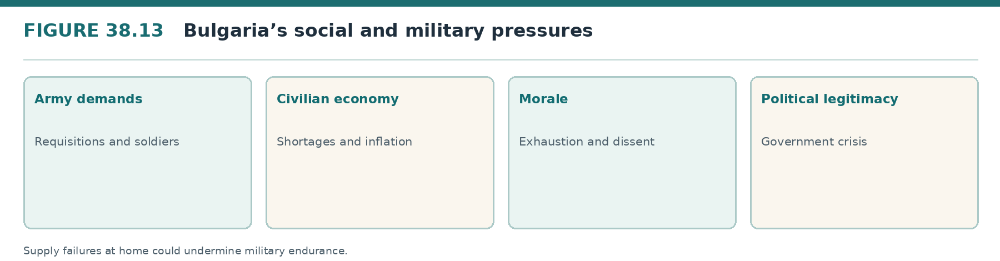

Bulgarian wartime mobilization placed an extraordinary burden on a relatively small state. Military requisitions, inflation, labor shortages and the diversion of farm workers into the army strained households. Rural families depended on harvests while coping with missing men, transport difficulties and uncertain access to supplies. Soldiers received reports of hardship at home; families awaited pay, leave, news and eventual peace. War finance increasingly shaped internal politics, and the government's ability to deliver a military victory became central to its legitimacy.

Opposition to the war did not necessarily mean support for Bulgaria's enemies. Agrarian leader Aleksandar Stamboliyski opposed entry into the conflict and was imprisoned; others criticized the government for different reasons. By 1918 exhaustion was widespread. The Bulgarian experience demonstrates how military performance and political consent can diverge: a soldier may defend a position effectively while deciding that the continuing war no longer serves the country. The state's fiscal and social capacity was not unlimited, and every additional campaign intensified the contradiction between its national objectives and the population's ability to sustain them. \[<a href="/038-world-war-i-causes-and-consequences/sources/#source-25" class="cite">25</a>\]\[<a href="/038-world-war-i-causes-and-consequences/sources/#source-26" class="cite">26</a>\]

<figure class="figure" id="figure-38-13">

<figcaption>Figure 38.13. Bulgaria’s social and military pressures <a class="figure-anchor" href="#figure-38-13" aria-label="Link to this figure">#</a></figcaption>
</figure>
