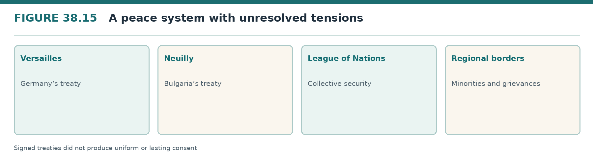

The peace system included agreements with Austria at Saint-Germain, Hungary at Trianon, Bulgaria at Neuilly and the Ottoman Empire at Sèvres, though the latter settlement was not implemented as originally envisioned. Political and military struggle in Anatolia led instead to the Treaty of Lausanne in 1923, which recognized the sovereignty of the Turkish Republic within a different framework. Meanwhile former Ottoman Arab territories were organized partly through League of Nations mandates under British and French administration. A mandate was presented as international supervision, but many local inhabitants understood it as a continuation of external domination.

The map that emerged after 1918 was not a universal application of self-determination. National claims, economic interests, colonial ambitions and strategic routes all influenced outcomes. Anti-colonial activists in Asia, Africa and the Middle East drew lessons from wartime promises and postwar disappointments. The war altered the balance of power but did not dismantle empire as a governing principle; in some places imperial rule actually expanded under new legal language. \[<a href="/038-world-war-i-causes-and-consequences/sources/#source-13" class="cite">13</a>\]\[<a href="/038-world-war-i-causes-and-consequences/sources/#source-30" class="cite">30</a>\]

<figure class="figure" id="figure-38-15">

<figcaption>Figure 38.15. A peace system with unresolved tensions <a class="figure-anchor" href="#figure-38-15" aria-label="Link to this figure">#</a></figcaption>
</figure>
