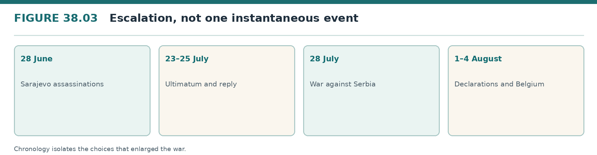

Bosnia-Herzegovina had been occupied and administered by Austria-Hungary since 1878 and formally annexed in 1908. Its inhabitants included Muslims, Orthodox Christians, Catholics and others whose political identities did not align neatly. Some South Slav activists sought union with Serbia or a broader South Slav state; others favored different arrangements or opposed revolutionary violence. The group later known as Young Bosnia was associated with varied political ideas. Gavrilo Princip was one of several conspirators. Elements of a Serbian clandestine network, including figures linked to the Black Hand and military intelligence, assisted the plot.

An essential distinction is between the actions of conspirators, the involvement of particular Serbian officers, and the responsibility of the Serbian civilian government. Evidence for clandestine assistance is much stronger than any simple claim that all Serbian political authorities ordered the murder. Franz Ferdinand's death challenged Habsburg prestige and security, but it did not prove that destroying Serbian sovereignty was necessary. To assess the subsequent crisis, ask what the investigators knew, what officials suspected, and what they were willing to risk in pursuit of a wider political objective. \[<a href="/038-world-war-i-causes-and-consequences/sources/#source-1" class="cite">1</a>\]\[<a href="/038-world-war-i-causes-and-consequences/sources/#source-6" class="cite">6</a>\]

<figure class="figure" id="figure-38-3">

<figcaption>Figure 38.3. Escalation, not one instantaneous event <a class="figure-anchor" href="#figure-38-3" aria-label="Link to this figure">#</a></figcaption>
</figure>
