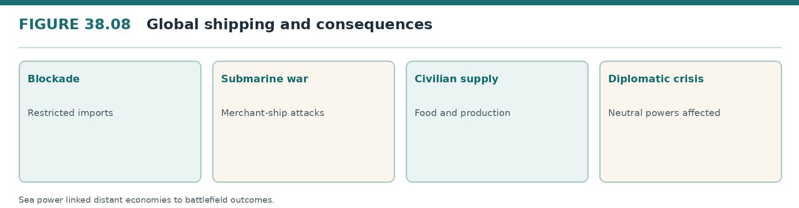

The Royal Navy and allied fleets sought to control maritime routes and restrict the import of supplies into the Central Powers. Germany deployed submarines against merchant shipping and sometimes passenger ships, creating diplomatic crises over the law of naval warfare and the lives of neutrals. The sinking of the Lusitania in May 1915 became especially prominent, but the United States did not enter the war immediately. The British-led blockade and German countermeasures affected food, fuel, trade, insurance and industrial output.

Naval warfare included surface battles, mines, convoys and the protection of imperial communications. The Battle of Jutland in 1916 was a major fleet engagement, but the strategic question was not settled by counting the vessels lost on one day. In 1917 German leaders resumed unrestricted submarine warfare in the hope of bringing Britain to its knees before American intervention could have decisive effects. That gamble instead helped push the United States into the conflict. A shipping map is as important here as a map of trenches, because the ability to feed populations and supply factories depended on the seas. \[<a href="/038-world-war-i-causes-and-consequences/sources/#source-17" class="cite">17</a>\]\[<a href="/038-world-war-i-causes-and-consequences/sources/#source-18" class="cite">18</a>\]

<figure class="figure" id="figure-38-8">

<figcaption>Figure 38.8. Global shipping and consequences <a class="figure-anchor" href="#figure-38-8" aria-label="Link to this figure">#</a></figcaption>
</figure>
