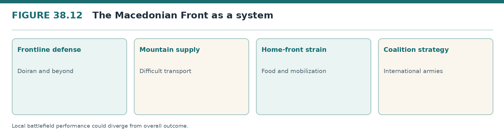

The Allies established forces around Thessaloniki, often called Salonika in contemporary English accounts, and the front eventually extended across a broad region of southern Macedonia and adjacent areas. French, British, Serbian, Italian, Russian and Greek contingents served at different times, while Bulgarian forces made up much of the opposing line alongside German and other Central Powers personnel. Difficult mountain terrain, summer disease, muddy transport routes and complex multinational command hindered operations. Both sides built defensive positions, but the line was not geographically identical to the Western Front's continuous trench network.

For Bulgaria the front demanded soldiers, ammunition, transport animals and food year after year. Battles around Doiran illustrated strong defensive performance by Bulgarian troops in several operations, but success at a local position could not guarantee the survival of the wider front. Soldiers also had to weigh their own families' hardships at home. A strategically important front can be forgotten in later global narratives because the final crisis appears elsewhere; the Balkan theater nevertheless played a central role in the collapse of the Central Powers in 1918. \[<a href="/038-world-war-i-causes-and-consequences/sources/#source-25" class="cite">25</a>\]\[<a href="/038-world-war-i-causes-and-consequences/sources/#source-27" class="cite">27</a>\]

<figure class="figure" id="figure-38-12">

<figcaption>Figure 38.12. The Macedonian Front as a system <a class="figure-anchor" href="#figure-38-12" aria-label="Link to this figure">#</a></figcaption>
</figure>
