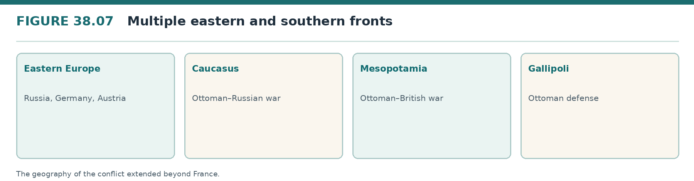

The Ottoman Empire entered the war on the Central Powers' side in late 1914 after a complex sequence of diplomatic and naval decisions. Its forces confronted Russia in the Caucasus and the British Empire in Mesopotamia, the Sinai and Palestine. The Allied Gallipoli campaign of 1915 sought to force the Dardanelles and change the strategic situation, but Ottoman defense prevented the hoped-for breakthrough. Disease, difficult terrain, inadequate supplies and command failures shaped these campaigns as much as battlefield tactics.

Britain sought to protect imperial routes and strategic resources, while Ottoman leaders struggled to defend a diverse empire under economic and political stress. Arab forces joined different sides for reasons that included local rivalries, opportunities and aspirations for self-government. Treating the Arab Revolt as the spontaneous voice of every Arab inhabitant would ignore divisions among communities. The British advance through Palestine and Mesopotamia, the fighting in the Caucasus and the contest over sea routes made the war global in military scope and created disputes that would persist after the Ottoman defeat. \[<a href="/038-world-war-i-causes-and-consequences/sources/#source-13" class="cite">13</a>\]\[<a href="/038-world-war-i-causes-and-consequences/sources/#source-14" class="cite">14</a>\]

<figure class="figure" id="figure-38-7">

<figcaption>Figure 38.7. Multiple eastern and southern fronts <a class="figure-anchor" href="#figure-38-7" aria-label="Link to this figure">#</a></figcaption>
</figure>
