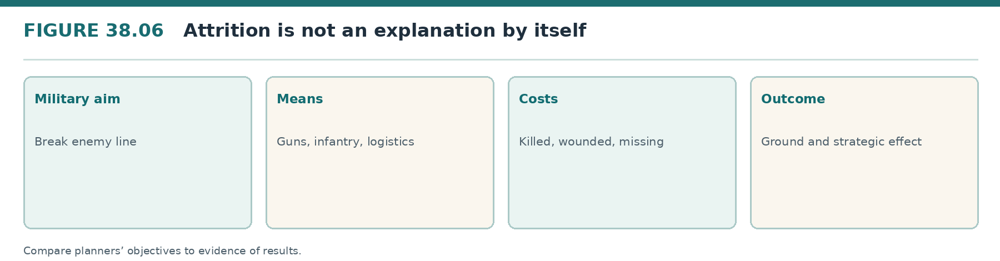

The 1916 Battle of Verdun became an enduring symbol of the French army's endurance and the appalling human cost of prolonged operations. The Battle of the Somme, begun by British and French armies in July 1916, likewise produced hundreds of thousands of casualties over months of fighting. The first day of the British offensive was especially devastating. Exact casualty totals vary depending on definitions—killed, wounded, missing and prisoners—and on the period included. We should resist using enormous numbers as a substitute for explaining strategic objectives and battlefield conditions.

Attrition did not simply mean that generals wanted to kill the largest possible number of opponents. Some commanders believed repeated attacks could weaken the enemy's reserves or break defensive systems; others were constrained by political demands to support allies. Those calculations could prove grievously mistaken. Assessing an offensive involves asking what its planners hoped to achieve, what information they possessed, how losses were distributed, and whether its consequences justified its cost. Memory later transformed Verdun and the Somme into national symbols, but national remembrance is not the same as a complete account of the events. \[<a href="/038-world-war-i-causes-and-consequences/sources/#source-7" class="cite">7</a>\]\[<a href="/038-world-war-i-causes-and-consequences/sources/#source-9" class="cite">9</a>\]

<figure class="figure" id="figure-38-6">

<figcaption>Figure 38.6. Attrition is not an explanation by itself <a class="figure-anchor" href="#figure-38-6" aria-label="Link to this figure">#</a></figcaption>
</figure>
