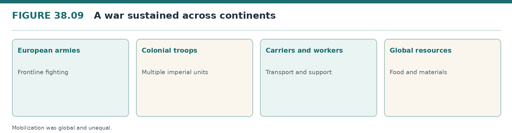

European colonial empires brought soldiers, laborers, sailors and resources from across the world into the conflict. Indian soldiers served in Europe, the Middle East and other theaters. African units, including French colonial forces and troops from British possessions, fought and supplied armies. War campaigns in East Africa involved German colonial troops, African askaris, and vast numbers of carriers whose forced or pressured labor exposed them to disease, exhaustion and danger. Japan joined the Allied side, seized German holdings in China and the Pacific, and used the conflict to pursue regional ambitions.

A global account must examine unequal relationships within these forces. Some men volunteered for pay, loyalty, status or local opportunity; others were conscripted or recruited through coercive structures. Their experiences could produce demands for political recognition after the war, but not every veteran became a nationalist. African and Asian civilians faced requisitions, displacement and disrupted commerce. Europe's war was never solely European, even if many European commemorations concentrate on the Western Front. \[<a href="/038-world-war-i-causes-and-consequences/sources/#source-20" class="cite">20</a>\]\[<a href="/038-world-war-i-causes-and-consequences/sources/#source-21" class="cite">21</a>\]

<figure class="figure" id="figure-38-9">

<figcaption>Figure 38.9. A war sustained across continents <a class="figure-anchor" href="#figure-38-9" aria-label="Link to this figure">#</a></figcaption>
</figure>
