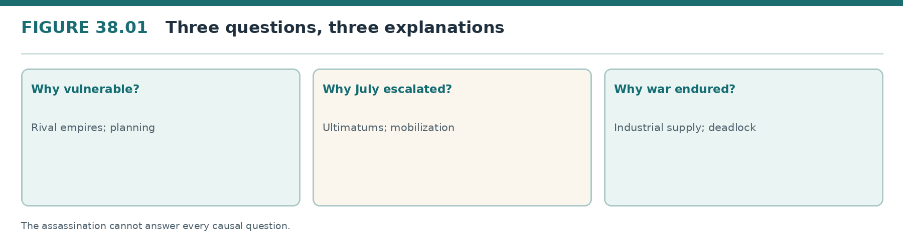

There are at least three different historical questions: why Europe was vulnerable to war, why the July 1914 crisis escalated, and why the resulting fighting lasted more than four years. Answers appropriate to one question cannot simply be reused for another. Nationalist agitation helps explain conflict in Bosnia but does not fully explain British naval policy or the fighting in Mesopotamia. Alliances affected expectations during the crisis, but they did not directly dictate every government decision. Industrial production helps explain how armies sustained terrible losses but tells us little about the motives of the Sarajevo assassins.

A useful causal model separates background conditions, immediate decisions and wartime mechanisms. The background included imperial competition, nationalism, mobilization systems and fears of decline. Immediate decisions included Austria-Hungary's ultimatum, Germany's support, Russia's mobilization, French diplomatic commitments and Germany's invasion of Belgium. The mechanisms of prolonged war included defensive firepower, military learning, economic resources, political commitments, and the difficulty of reaching a negotiated settlement when governments feared defeat would be disastrous. Historians dispute the relative weight of these factors; a serious book should not convert one compelling slogan into an exclusive explanation. \[<a href="/038-world-war-i-causes-and-consequences/sources/#source-1" class="cite">1</a>\]\[<a href="/038-world-war-i-causes-and-consequences/sources/#source-3" class="cite">3</a>\]

<figure class="figure" id="figure-38-1">

<figcaption>Figure 38.1. Three questions, three explanations <a class="figure-anchor" href="#figure-38-1" aria-label="Link to this figure">#</a></figcaption>
</figure>
