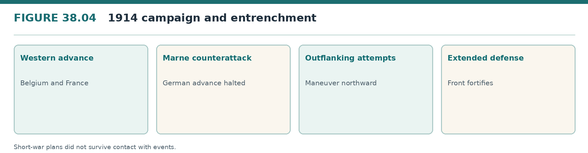

Historians have argued about responsibility since 1914. Contemporary governments published selected diplomatic documents to defend their decisions. The 1919 peace settlement assigned substantial legal responsibility to Germany and its allies, but the historical question is wider than the wording of a treaty. Scholars debate the extent to which German backing enabled Habsburg escalation, whether Vienna was determined to fight, how Russian mobilization changed the crisis, and whether French and British diplomacy could realistically have stopped it. The claims are not equally supported merely because they exist; evidence still matters.

The strongest explanation distinguishes agency from context. Serbian nationalist violence mattered, and clandestine support deserves scrutiny. Austrian decision-makers chose an exceptionally confrontational policy. German leaders accepted severe risks and chose to wage war against France through Belgium. Russian and French leaders made consequential commitments and calculations. British hesitation and later intervention belonged to a separate decision process. Rather than trying to identify a single 'cause' that absolves everyone else, ask which decisions made a general European war more probable and how credible alternatives appeared at the time. \[<a href="/038-world-war-i-causes-and-consequences/sources/#source-1" class="cite">1</a>\]\[<a href="/038-world-war-i-causes-and-consequences/sources/#source-3" class="cite">3</a>\]

<figure class="figure" id="figure-38-4">

<figcaption>Figure 38.4. 1914 campaign and entrenchment <a class="figure-anchor" href="#figure-38-4" aria-label="Link to this figure">#</a></figcaption>
</figure>
